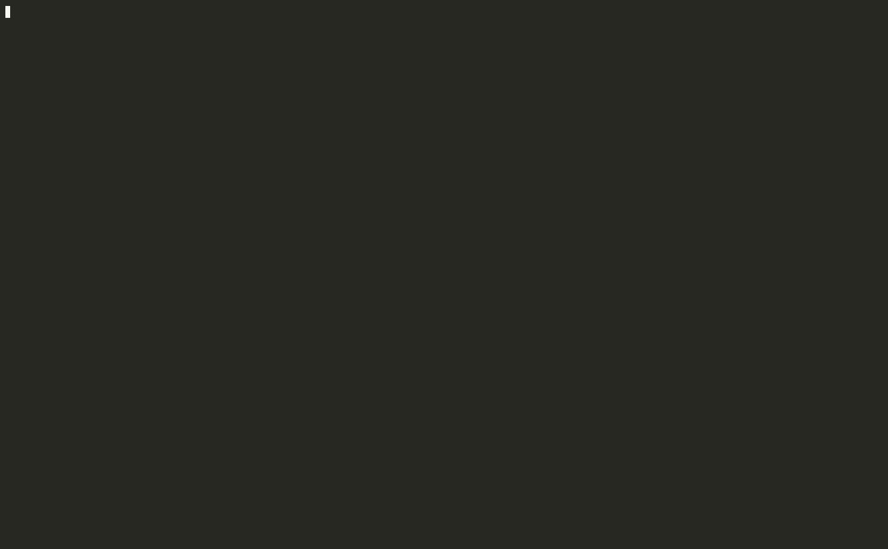

# AgentThread (`agt`)

AgentThread is a local orchestrator that runs a team of coding agents inside the [Herdr](https://herdr.dev) terminal multiplexer. You talk
to one **main manager**. For every feature, bug or chore it opens a **thread** with its own **coordinator**, which
splits the work into tickets and starts **workers**, one per ticket, in git worktrees. A **review** (of a PR, a branch or
a finding) or a **report** (how some logic in the project works) runs as a thread too, and ends in one Markdown report
you can share.



*The demo, at 2× speed: the main manager drafts and opens a thread, the coordinator writes two tickets, and two workers
implement them in parallel in their own worktrees. The coordinator then reviews and accepts each ticket and squashes the
work for the PR. The run took about two minutes; its workspace comes from [`demo/`](demo/README.md).*

A small local daemon keeps the state: an append-only event log, rendered as Markdown under `.agentthread/`. Agents
report back with `agt` commands, and the daemon enforces the rules (who may commit what, who may talk to whom).
AgentThread is agent-agnostic: Claude Code, OpenCode, Codex, omp and Antigravity can each fill any role, and you can
mix them.

Why use it:

- **Parallel work without collisions.** Every task gets its own worktree per repo, and every ticket lists the files its worker may touch.
- **One session per ticket.** Small, focused agent sessions instead of one long conversation that rots.
- **Guards.** Workers cannot commit outside their ticket, nobody pushes, banned words stay out of commits.
- **A reviewable flow.** A ten-stage workflow (discussion, spec, tickets, review per commit, staged e2e, release notes) with you approving the decisions that matter.
- **Reviews and reports that are safe to share.** A four-stage doc workflow ends in one Markdown report; agt refuses to finish while it mentions anything private.

```
        you
         |
   +-----v------+      events / state       +-----------------+
   |    main    |<------------------------->|   agt daemon    |
   |  (manager) |                           |   event log,    |
   +-----+------+                           |   rendered .md  |
         | agt thread new                   +--------^--------+
   +-----v---------------+  one Herdr tab per        |
   | thread: coordinator |  thread                   |
   +-----+---------------+---------------------------+
         | agt worker spawn (one per ticket)         |
   +-----v-----+  +-----------+  +-----------+       |
   | worker T1 |  | worker T2 |  | worker T3 |-------+
   +-----------+  +-----------+  +-----------+
   .worktrees/<task>/<repo> on wip/<task>
```

## Requirements and install

- [Bun](https://bun.sh) 1.1.34 or newer
- git
- [Herdr](https://herdr.dev) (agents run in its panes; `agt start` must run inside a Herdr pane)
- At least one supported agent CLI, installed and logged in (see [Supported agents](#supported-agents))

The package is private (not published to npm). Install from a clone, or let the [`/agt-setup` skill](#set-up-with-claude-code-recommended) do it for you:

```sh
git clone https://github.com/agungsptr/AgentThread.git agentthread
cd agentthread
bun install
bun link        # puts `agt` on your PATH
```

## Set up with Claude Code (recommended)

The fastest way to get started is the `/agt-setup` skill from the [agungsptr/skills](https://github.com/agungsptr/skills)
plugin marketplace. Install it once:

```
/plugin marketplace add agungsptr/skills
/plugin install agt-setup@agungsptr
```

Then open Claude Code in your project or workspace folder and run:

```
/agt-setup
```

What it does:

1. **Installs agt when it is missing.** It checks Bun, git, Herdr and your agent CLIs, then (after you say yes) clones
   this repository to `~/.agentthread/AgentThread`, runs `bun install` and `bun link`. When agt is already installed
   from a clone that is behind, it offers an update. It never uses `sudo`, never installs Herdr or Bun without asking,
   and never edits your shell profile.
2. **Initialises the project** with `agt init --no-setup` (no wizard).
3. **Analyses the repos read-only:** branches and CI, package scripts and lockfiles, ports and health URLs, migrations,
   env files to copy into worktrees, existing Makefiles and scripts. It never reads secret values, and never starts
   services, runs migrations, installs project dependencies, runs tests or commits.
4. **Shows one proposal** (every value with its evidence) and asks **one batch of questions** for what it cannot infer,
   such as which agent and model to use per role.
5. **Applies it** with `agt config apply --dry-run`, shows the diff, then applies on your OK.

When it finishes, run `agt start` inside a Herdr pane. Re-run `/agt-setup` any time: it keeps the existing config and
only proposes corrections. To get a newer version of the skill, run `/plugin marketplace update agungsptr`.

Prefer to do it by hand? Install as above and follow the [Quick start](#quick-start).

## Supported agents

| Agent | `agent:` value | Notes |
|---|---|---|
| Claude Code | `claude-code` | Has hooks: reports context size and pre-compact events, so context-based rotation works |
| OpenCode | `opencode` | Runs with `--standalone`; effort is a variant of the model (`provider/model#effort`), so it needs a `model` |
| Codex | `codex` | `brew install --cask codex`, then `codex login`; started with the project and worktree marked trusted |
| omp | `omp` | Use the standalone binary from omp.sh |
| Antigravity | `agy` | Google Antigravity CLI; reads `AGENTS.md` and `.agents/skills` |

Any agent can fill any role (main, coordinator, worker). Only Claude Code has hooks today: for the others agt relies on
Herdr's status polling, so they do not report context size or trigger rotation on compaction. Per-agent CLI facts and
how to add an agent: [docs/agents.md](docs/agents.md).

`AGT_CLAUDE_BIN`, `AGT_OPENCODE_BIN`, `AGT_CODEX_BIN`, `AGT_OMP_BIN` and `AGT_AGY_BIN` override the executable of the
main manager's launch only. Coordinators and workers are started by Herdr, which picks the executable itself.

## Quick start

### One repository

```sh
cd your-repo
agt init        # creates .agentthread/; on a terminal it offers the setup wizard
agt start       # run it inside a Herdr pane
```

`agt start` sets up the layout (a main tab with the manager and a logger pane) and opens the main manager. Then just
describe a feature or bug to it. After you confirm, it creates a thread; the coordinator and workers take it from there.

### A multi-repo workspace

Run agt in the folder that contains your repositories (for example `api/` and `web/`). Without `workspace.repos`,
the root's child git repos are used.

```sh
cd my-workspace
agt init --no-setup                 # no wizard, no prompts: safe from scripts and agent shells
agt config apply my-config.yaml     # validates, merges into .agentthread/config.yaml, prints the diff
agt start                           # inside a Herdr pane
```

`my-config.yaml` is a partial config such as the example under [Configuration](#configuration). Prefer a guided
setup? `agt setup` (also offered by `agt init` and `agt start` on a terminal) asks for the agent, model and effort per
role and for complexity tiers, and can be re-run at any time.

`agt help` prints the usage. `agt help <command>` (or `agt <command> --help`) prints only that command's lines and never
runs it.

## Concepts

### Roles

| Role | What it does | Never |
|---|---|---|
| **Main** | The agent you talk to. Opens threads, relays decisions, closes finished threads and cleans up | Implement tasks |
| **Coordinator** | One per thread, in its own Herdr tab. Discusses the task with you, writes the spec and tickets, spawns workers, reviews every commit, runs e2e, squashes for the PR | Edit repo files itself, push |
| **Worker** | One per ticket, in a pane of the thread's tab. Edits only its ticket's files and reports back | Commit outside its list, push, amend, rebase |

You decide, push and open PRs. Agents never push.

### Threads

A thread has a type. `feature`, `bug` and `chore` are **code threads**: they run [the ten stages](#the-ten-stages) and
the type decides the branch prefix of their final squash branch. `review` and `report` are **doc threads**: they change
no code and run [the doc workflow](#review-and-report-threads).

| Type | Kind | Squash branch |
|---|---|---|
| `feature` | code | `feat/<task>` |
| `bug` | code | `fix/<task>` |
| `chore` | code | `chore/<task>` |
| `review` | doc | none |
| `report` | doc | none |

Override a code prefix with `workflow.branch_prefix` (`wip` and `thread` are refused: guard branches use them). Main
creates threads with `agt thread new <title...> --type feature|bug|chore|review|report`. It can also propose a complexity tier
(`--tier <name> --reason <why>`): the thread waits for your `agt thread choose <id> --tier <name>` (or
`agt thread cancel <id>`), and when `agents.complexity.timeout` runs out the proposed tier is accepted automatically.
`agt thread cancel <id> [--reason <text>]` also stops a running thread, whatever its status: its agents end, its tab
closes and it is done. Its worktrees and branches stay until `agt thread cleanup <id>`.

### Tickets and file lists

A ticket is one unit of work for one worker. In a task thread it names its repo and the repo-relative files the worker
may change:

```sh
agt ticket add <thread> "Add slugify" --repo api --file src/slug.ts --file src/slug.test.ts --doc <ticket-file>
```

Repeat `--file` for every path (`a b` is not two files; directories are not accepted). The commit guard refuses any other
staged file. The coordinator fixes a wrong list with `agt ticket files <thread>/<T> --add <path> --remove <path>` (not for
a done ticket, never down to zero files); without flags it prints the list. A ticket the guard blocked is reopened with
`agt ticket reopen` after the fix.

Lifecycle: `claim`, work, `done` (goes to review), then the coordinator runs `accept` (the worker ends) or
`return <what to fix>` (back to the worker). A worker with a question runs `agt question` and the coordinator answers
with `agt answer`; a blocked ticket (`agt ticket block --reason`) is reported to the coordinator. `agt tell
<thread>/<T> "<text>"` reaches a ticket's live worker.

### The ten stages

Each task thread moves through these stages, recorded with `agt stage <thread> <1-10> done|skipped|na`. A small task
compresses them; a stage is skipped only when you say so.

| # | Stage | What happens |
|---|---|---|
| 1 | Task discussion | Compare the task with the code and docs, decide story by story with you |
| 2 | Spec | Rules, decisions, API contract, out of scope, ticket table |
| 3 | Tickets | One ticket per unit of work, each with the files it may edit |
| 4 | Delegation | `agt worker spawn`; each worker gets its ticket and worktree |
| 5 | Review per commit | Diff within the ticket's files, tests re-run, accepted or returned |
| 6 | Combined verification | Unit suite and type check once per repo |
| 7 | Staged e2e | Narrow suites first; the full run only after your approval (`stage 7 approve --by user`) |
| 8 | Browser check | Only on request (`agt thread new ... --browser-check`, or `agt thread browser-check <id>` / ask the coordinator later; `workflow.browser.check: always` makes it required): the coordinator checks the UI against the design. Otherwise agt records it skipped |
| 9 | Shared feature docs | New docs in each touched repo |
| 10 | Release and handover | Release notes with manual migration SQL, one squashed commit on `feat/<task>` (or `fix/`, `chore/`); you push |

The workflow text lives in `src/workflow/feature-workflow.md` and is written into the project as a generated skill.

### Review and report threads

A `review` thread reviews a PR, a branch or a finding; a `report` thread explains logic in the project (how something
works, with examples). Both end in **one Markdown report** that you share as a file. It is kept in the private `.docs/`,
but its content must not point at anything private.

| # | Stage | What happens |
|---|---|---|
| 1 | Scope | What is reviewed or explained, for whom, from which branch or PR; detached checkouts are created |
| 2 | Investigation | The coordinator reads the code or the diff; a worker is spawned only to verify something (run tests, reproduce a finding) |
| 3 | Draft | The report is written and recorded with `agt thread report <id> <path>` |
| 4 | Approval | You approve it and agt's share check passes; the thread goes to review, main closes it and cleans up |

- **The report.** `.docs/<repo or shared>/reviews/YYYY-MM-DD-<slug>.md` for a review,
  `.docs/<repo or shared>/reports/YYYY-MM-DD-<slug>.md` for a report.
- **The share check.** `agt thread report <id> --check` lists every line that mentions `.docs`, `.agentthread`,
  `.worktrees`, the workspace path, the thread's id or a ticket (`thread 004`, `004/T2`, `ticket T3`) or a
  `workflow.banned_words` entry (whole words). `agt stage <id> 4 done` runs the same check and refuses while a hit, a
  missing file or an empty file remains. Stage 4 cannot be skipped.
- **No code changes.** `agt worktree add` makes a detached checkout (no `wip/<task>`, no squash branch), the commit guard
  refuses every agent commit in it, and tickets take `--repo` without `--file`. Workers may leave throwaway files
  (a reproduction test); cleanup removes them.
- **Finishing.** The coordinator tells main `"<id>: report approved: <path>"`; main marks the thread done and runs
  `agt thread cleanup <id>`, which force-removes the worktrees without any merge check.

The workflow text lives in `src/workflow/doc-workflow.md` and is generated as the `agt-doc-workflow` skill.

### Worktrees

Tickets of one task share one worktree per repo: `.worktrees/<task>/<repo>`, on a branch `wip/<task>` created from the
source branch (a review or report thread's worktree is a detached checkout of the source instead, with no branch). `agt worktree add <thread> <repo> [--from <branch>]` creates it in the background and the coordinator is
told when it is ready. `wip/<task>` keeps the per-ticket history and is never pushed; the squash branch is what you push.
agt sets `extensions.worktreeConfig = true` in the repository config (needed for per-worktree excludes and the commit
guard); the main checkout is otherwise untouched.

### Guards

- **Worker commit guard.** Each thread worktree gets its own `core.hooksPath` whose `pre-commit` refuses a commit from a
  worker, or one that stages files outside its ticket, then forwards to your own hooks. The coordinator reviews and
  commits. In a review or report thread it refuses every agent commit. The hooks apply only to processes launched by agt (`AGT_AGENT_PROCESS`).
- **Never push.** Agent prompts forbid pushing, amending, rebasing, resetting and `git add -A`.
- **Banned words.** `workflow.banned_words` are added to the commit-message rule given to every agent.
- **Autonomy.** With `agents.autonomous: true` (default) agents run without approval prompts. Set it to `false` to keep
  each agent's own prompts; workers then only run commands they may run unprompted and block when a ticket needs another.

### Coordinator rotation and handoff

Long sessions degrade, so a coordinator is replaced by a fresh one that continues from a handoff. Triggers are set in
`session.rotation`: `on_precompact`, `context_threshold` (fraction of `context_window`), `max_turns`, `max_age` and
`idle_timeout`. The daemon asks the old coordinator for a handoff (`agt handoff <thread> --stdin`), validates it, and
generates one from the log when the agent does not answer within `session.handoff.timeout`. Context size and
pre-compact events are only available from agents with hooks (Claude Code today).

### Language

`workflow.chat_language` is the language agents use when talking to you; `workflow.file_language` is the language of
files, code, commits and `agt` commands. Both default to `English` and are the first rule in every agent's prompt.

## Configuration

Two layers, deep-merged: the user config `~/.config/agentthread/config.yaml` (or `$XDG_CONFIG_HOME/agentthread/`) and
the project config `.agentthread/config.yaml`, which wins. Maps merge, lists replace. Use `agt config show [--json]` to
see the effective config and where each layer came from, and `agt config apply <file|-> [--dry-run] [--no-restart]` to
merge a partial YAML or JSON config into the project file (comments are kept, the result is validated, a diff is
printed, and a running daemon is restarted when the config changed). Unknown keys are rejected.

An annotated example for a two-repo workspace:

```yaml
agents:
  roles:                                  # agent, model and effort per role
    main:        { agent: claude-code, model: opus, effort: high }
    coordinator: { agent: claude-code, model: sonnet }
    worker:      { agent: opencode, model: myrouter/model }
  complexity:                             # optional tiers main can propose per thread
    timeout: 10s                          # how long a proposal waits for your choice (min 1s)
    tiers:
      simple:  { agent: claude-code, model: haiku }
      complex: { agent: claude-code, model: opus, effort: high }
  autonomous: true                        # false keeps each agent's approval prompts
  skill: true                             # false stops writing the generated skills
workers:
  max_workers: 3                          # per thread; extra spawn requests are queued

workspace:
  repos:
    api:
      path: api                           # relative to the project root
      source_branch: main
      copy: [.env]                        # copied into each new worktree (never overwrites)
      link: [node_modules]                # symlinked from the main checkout
      install: ""                         # unset: detected from the lockfile; "" disables
    web:
      path: web
      source_branch: main
      copy: [.env.local]
  services:                               # the local stack, see "Workspace stack"
    db:
      repo: api
      start: docker compose up -d db
      port: 5432
      health: tcp:5432
    api:
      repo: api
      start: bun run dev
      port: 3000
      health: http://localhost:3000/health
      migrate: bun run migrate            # opt-in: only with --migrate
      migrate_on_start: false
      env: { DATABASE_URL: postgres://localhost/app }
      after: [db]                         # start order
    web:
      repo: web
      start: bun run dev
      port: 5173
      after: [api]

workflow:
  chat_language: English
  file_language: English
  branch_prefix: { feature: feat, bug: fix, chore: chore }
  banned_words: [ai-generated]
  e2e:                                    # commands for stages 2-4, plus the baseline
    stage2: bun test e2e/new
    stage3: bun test e2e/related
    stage4: bun test e2e
    baseline: .docs/e2e-baseline.md
  migration:
    tool: knex
    table: knex_migrations
    prod_migrates_on_start: false
  browser:
    urls: [http://localhost:5173]
    login_note: log in as the seeded demo user
    check: on_request                     # or always: stage 8 only when asked (default), or whenever urls are set

session:
  rotation:
    on_precompact: true
    context_threshold: 0.7                # fraction of context_window
    context_window: 200000
    max_turns: 150
    max_age: 8h
    idle_timeout: 24h
```

Other `workflow` keys: `stack.restart` / `stack.status` (default to `agt stack restart --task {task}` and
`agt stack status` when services exist), `prod_read`, `never_commit`, `read_first`, `report_words`. Other sections:
`herdr` (`main_tab_label`, `close_tab_on_done`, `close_worker_pane_on_end`, `poll_interval`), `checkpoint`,
`session.handoff`, and per-repo `prod_branch`, `staging_branch`, `pr_order`, `unit`, `typecheck`.

Notes on workspace settings:

- `copy` entries are copied from the main checkout into each worktree (recursive, symlinks skipped, missing ones skipped
  with a note). `link` entries are symlinked instead; with `node_modules` linked, `install` is skipped unless the lockfile
  differs from the main checkout's.
- `worktree_setup` (a command with `{root}`, `{task}`, `{repo}`, `{src}`, `{path}` placeholders, used unquoted) replaces
  the built-in worktree creation, copy and install. It must leave `{path}` checked out on `wip/<task>`.
- `agt config show` and `config apply` warn about a tracked `copy` entry and about a browser URL port no service uses.

**Agent environment.** `agents.env` sets environment variables for every agent agt launches (main, coordinators,
workers), and a role's or tier's own `env` is merged over it. This matters with several Claude Code accounts: you pick
one with `CLAUDE_CONFIG_DIR` (usually in a shell alias), but agt launches agents with the environment of the Herdr
session, so a session opened from a shell without it starts `claude` on the default config and asks to log in and trust
folders again. Set it once in the config instead:

```yaml
agents:
  env:
    CLAUDE_CONFIG_DIR: ~/.claude-work     # a leading ~/ and $HOME expand to your home directory
  roles:
    worker: { agent: claude-code, env: { CLAUDE_CONFIG_DIR: ~/.claude-other } }
```

Keys must match `[A-Za-z_][A-Za-z0-9_]*`, and `AGT_*` and `HERDR_*` are agt's own and refused. An agent's adapter wins
for the few variables it sets itself. `agt config show` and `config apply` print the keys but show every value as `***`.
`agt start` prints which `CLAUDE_CONFIG_DIR` the claude-code agents will use.

A role's `effort` must be one the agent accepts; a bad value is rejected when the config loads.

#### Several Claude accounts

With two or more `agents.claude.profiles`, agt reads each account's usage limits and launches every new Claude Code agent
on the right one, switching before an account runs out. With none or one profile nothing changes (one profile is the
same as `agents.env.CLAUDE_CONFIG_DIR`).

```yaml
agents:
  claude:
    profiles:                              # 2 or more turn switching on
      - { name: personal, config_dir: ~/.claude-a }
      - { name: work, config_dir: ~/.claude-b }
    switch_at: { five_hour: 90, seven_day: 95 }   # percent; these are the defaults
    statusline: ~/bin/my-statusline.sh     # optional: your own statusLine command, also run and shown
```

`name` is lowercase words (`[a-z][a-z0-9-]*`) and unique; `config_dir` expands a leading `~/` and `$HOME`. With 2 or
more profiles the config refuses `agents.claude.config_dir` and any `CLAUDE_CONFIG_DIR` in `agents.env` or a role's or
tier's `env`, because each profile sets it.

**How the choice works.** Claude Code reports usage only through its statusLine command, so agt gives every Claude Code
agent a statusLine that records the account's 5-hour and 7-day usage in `.agentthread/usage/<profile>.json` and prints a
short line with the session's model, effort level and context window
(`personal · Opus 5.5 · xhigh · ctx 68k/200k 34% · 5h 25% ↻14:10 · 7d 48%`); agt also adds a `StopFailure` hook for `rate_limit`, which marks the
account exhausted until its latest known reset (or 60 minutes). A profile is eligible while both windows are under
`switch_at` (a window past its reset counts as 0) and it is not marked exhausted. New launches stick to the current
profile while it is eligible (use up the first account). When it is not, agt picks the eligible profile whose 5-hour
window resets nearest (quota that resets soon is lost if unused), then the lowest 5-hour use, then the lowest 7-day use,
then config order; a profile with no data counts as 0% with an unknown reset. When none is eligible, the one that frees
up first is used and main is told. Every switch is a `profile.switched` event in `agt logs`.

- A coordinator whose profile crosses `switch_at` is rotated through the normal handoff (reason `usage limit`) onto the
  newly chosen profile, never while a handoff is in progress and at most once per 10 minutes per thread.
- A worker that hits the limit makes its coordinator hear it should `agt ticket return` the ticket so a fresh worker
  continues on another profile. Running workers are never moved.
- Main is only told (once) that its profile is near the limit; restart it later with `agt start`. It is never restarted
  automatically.
- `agt usage [--json]` shows each profile's usage, resets, last seen, limited mark and which one is current.

**What agt never reads:** any file inside a Claude config dir (credentials, settings, `.claude.json`) and your own
statusLine setting. agt only passes `CLAUDE_CONFIG_DIR` to the process.

**Trade-offs.** `--settings` replaces your own statusLine in agt's panes, so your line does not run there unless you set
`agents.claude.statusline` to its command (agt runs it with the same input and prints its output on a second line).
Usage data appears only after a session's first response, and only for Pro, Max and Ultra accounts; until then a profile
counts as unknown (0%). Claude Code asks once per config dir to trust a folder, so with several accounts each asks once:
`agt start` lists them (`Claude profile <name> (<config_dir>) asks once to trust <root>`).

### Generated files

`agt init`, `agt setup` and `agt start` write four skills into the project root, and every thread directory and
worktree gets them too, under both `.claude/skills/` and `.agents/skills/`: `agt` (how to use the CLI per role),
`agt-feature-workflow` (the ten stages, ending with a section rendered from your config), `agt-doc-workflow` (review and
report threads, with the same config section) and `manage-docs`. They are
regenerated, git-excluded, and never edited by hand. A skill of the same name that your project tracks is left alone.
Set `agents.skill: false` to turn this off.

## Workspace stack

When `workspace.services` is configured, agt can run your local stack. These commands need no daemon.

```sh
agt stack start [--task <slug>|--main] [--only a,b] [--migrate]
agt stack stop [--only a,b] [--force]
agt stack restart [--task <slug>|--main] [--only a,b] [--migrate]
agt stack wait [--timeout <seconds>]
agt stack status [--json]
agt stack logs <service> [-f] [-n <lines>]
```

- Services start in `after` order and are waited on until healthy (`health`, default `tcp:<port>`; an HTTP 2xx-4xx
  answer counts as up).
- `agt stack restart` runs in the background. `agt stack wait` blocks until that restart has finished, printing its
  lines: exit 0 when every service is healthy, 1 when one failed (or the restart process died), 2 when it is still
  restarting at the timeout (default 540s, under an agent's 10-minute shell limit; run it again). Coordinators use it
  instead of a readiness loop of their own.
- `--task <slug>` runs the services from `.worktrees/<slug>/<repo>` where it exists; `--main` runs the main checkouts.
  The current target is recorded in `.local-run/task`.
- State lives in the git-ignored `.local-run/`: `<service>.pid`, `.log`, `.stamp` (install reruns when the checkout state
  changes), `.migrated`, and `restart.log`.
- **Migrations are opt-in.** A service's `migrate` command runs only with `--migrate` (or `make start MIGRATE=1`), or on a
  changed checkout when that service sets `migrate_on_start: true`.
- `env` values are merged over the inherited environment and never printed.
- The stack is shared by all threads, so a coordinator takes a lock around e2e and browser checks
  (`agt stack acquire <thread>` / `agt stack release <thread>`; the full e2e run needs your stage-7 approval).

With services configured, agt also generates a `Makefile` (a thin wrapper), `.agentthread/agt.mk` and `MAKEFILE.md`
(the targets and a services table). A Makefile of your own is never overwritten: add
`include .agentthread/agt.mk` to it instead.

```sh
make start TASK=my-task MIGRATE=1     # start from that task's worktrees, running migrations
make stop
make restart ONLY=api
make status
make logs SVC=api
make wt-new TASK=my-task REPOS=api,web SRC=main
```

## Day to day

**Watching.** The logger pane next to the main manager runs `agt logs -f`: one line per event
(`HH:MM:SS <thread|main> <role> <event> <summary>`), with heartbeats hidden. `agt logs --all` shows everything and
`agt logs` prints once. It survives daemon restarts. Run `agt start` again to repair a closed or ended logger pane.

**Waiting for you.** When a coordinator needs a decision it runs `agt thread waiting <id> "<what>"`, which tells main.
Asked again before you answer (in other words, or by a coordinator that replaced it after a rotation), it is not told
to main a second time.

**A busy coordinator.** Notices reach an agent when it goes idle. A Claude Code coordinator or worker that stays busy
gets them anyway after 3 minutes: Claude Code takes a message while it works and reads it at its next step (it wakes
from a wait on background work). Other agents keep waiting for their idle. When a coordinator has still not read its
notices after 10 minutes (for example stuck in a long wait of its own), main is told once, with the thread tab to check:
Esc there interrupts it so it reads them.

**After a merge.** When your PRs are merged, tell the thread's coordinator. It verifies each repo contains the squash
branch, releases the stack lock and tells main. Main then marks the thread done, restarts the stack on `main` if needed
and runs `agt thread cleanup <id>`, which removes the worktrees and `wip/<task>` branches (it stops on uncommitted
changes). Do not remove worktrees or branches by hand.

**After a report is approved.** A review or report thread has no PR: once you approve its report, the coordinator tells
main, which marks the thread done and cleans up. The report stays in `.docs/`, ready to share.

**The daemon.** `agt daemon start|stop|status`. `agt start` starts it when needed, and it keeps running if you close the
main pane.

**Upgrading agt.** A running daemon and the agents it started keep the old code and prompts. After upgrading:
`agt daemon stop`, close the running agents' panes, then `agt start`.

**Trust dialogs.** Claude Code asks once per folder whether you trust it. When main is Claude Code, it asks in main's
pane at `agt start` and the worktrees inherit the answer. If main is another agent but some role uses Claude Code,
`agt start` warns you to open `claude` once in the project root and accept. In folders agt creates itself
(`.worktrees/`), agt answers a coordinator's or worker's trust dialog; it never answers it in your own folders and never
touches Claude Code's config. With several Claude accounts, set `agents.env.CLAUDE_CONFIG_DIR` (see Configuration) so
every agent uses the same account and trust answers; `agt start` prints the one in use.

**Claude usage.** With several Claude accounts (see Configuration), `agt usage` shows each profile's 5-hour and 7-day
use, when they reset, when it was last seen, whether it is marked limited, and which one new agents start on.

**Stalled or idle workers.** A worker that stops without reporting is flagged to its coordinator (at most three times
per ticket); a worker that exits before claiming its ticket is replaced (at most twice). A session whose first turn runs
no `agt` command (often a model name that does not exist) is reported as `session.stalled`.

## Command reference

Run `agt help <command>` for exact flags.

| Area | Commands |
|---|---|
| Project | `init [--name] [--no-setup]`, `setup`, `start [--no-manager]`, `config`, `config show [--json]`, `config apply <file\|-> [--dry-run] [--no-restart]` |
| Daemon and logs | `daemon start\|stop\|status`, `logs [-f] [--all]`, `usage [--json]` |
| Threads | `thread new`, `thread choose`, `thread cancel`, `thread status`, `thread waiting`, `thread report <id> <path>\|--check`, `thread cleanup` |
| Tickets | `ticket add`, `ticket files`, `ticket claim\|reopen\|done\|accept\|return\|block` |
| Stages | `stage <thread> <1-10> done\|skipped\|na\|approve` (a review or report thread: `<1-4> done\|skipped\|na`) |
| Workers and worktrees | `worker spawn <thread> --ticket <T> [--agent <kind>]`, `worktree add <thread> <repo> [--from]` |
| Messages | `tell <thread\|main\|thread/ticket> <message>`, `question`, `answer`, `handoff`, `log`, `decide`, `note`, `progress` |
| Stack | `stack start\|stop\|restart\|wait\|status\|logs`, `stack acquire\|release` |
| Help | `guide [main\|coordinator\|worker\|all]`, `help [<command>]` |
| Internal | `event started\|active\|idle\|compacting\|ended`, `event rate-limited --profile <name>`, `statusline --profile <name> --root <root>` (used by Claude Code hooks and its statusLine) |

## Development

```sh
bun install
bun test            # never starts real agents or your Herdr; a leak guard kills stray test daemons
bun run typecheck   # tsc --noEmit
```

When you run the tests from inside a Herdr pane, unset Herdr's variables so nothing can reach your live session:

```sh
env -u HERDR_ENV -u HERDR_WORKSPACE_ID -u HERDR_TAB_ID -u HERDR_PANE_ID -u HERDR_SOCKET_PATH bun test
```

### Release check

`bun run e2e:release` runs real agents against isolated, headless Herdr servers (it never touches your own session) and
**costs money**: a full run is about 23 rows of 5 to 20 minutes each. Use `--list`, `--only <ids>`, `--agents <kinds>` and
`--timeout <d>` to narrow it. Prerequisites, the one-time trust step and the matrix are in
[docs/release-e2e.md](docs/release-e2e.md).

## Status and limitations

AgentThread is early software, developed and tested on macOS; other platforms are untested. It targets Herdr and cannot
run without it. Only Claude Code reports context size and pre-compact events, so context-based rotation is limited for
the other agents. Codex's autonomous start and coordinator sandbox setup were verified from its `--help` only, not yet in
a full release run (see [docs/agents.md](docs/agents.md)). The package is not published to npm.

## License

[MIT](LICENSE)
